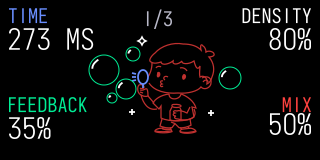

# Bubbler 1.0.0 — +bubbler port

**An OP-1 / Opus port of +bubbler, the granular-delay device by [Tom Erbe / SoundHack](https://www.soundhack.com/).**

Original device and granular-delay algorithm: **Tom Erbe / SoundHack**. OP-1 port and adaptation: **ESC_CODE**. Built on the **[Opus framework and plugin kit by LizardMan](https://github.com/LizardMan245/opus)**.

A granular delay for the **original Teenage Engineering OP-1**, running **firmware 246 with Opus 2 core 2.2 or later**.

[Download bubbler.opmod](https://github.com/VolkerJunginger/OP-1/raw/refs/heads/bubbler/Bubbler/bubbler.opmod) · [Short manual](Manual.md) · [Build and tests](Source/README.md)

Bubbler combines up to eight overlapping grains with variable timing, length, reversal, pitch and resonant feedback filtering. The wet engine is mono; the master slot retains stereo dry audio.

| Encoder | 1/3 — normal | 2/3 — Shift | 3/3 — Shift + right |
|---|---|---|---|
| Blue | Time | Time Var | Filter Freq |
| Green | Feedback | Start Var | Reso |
| White | Density | Size | Reverse |
| Orange | Mix | Size Var | Pitch Var |

Hold Shift and use left/right between the extra pages. Release Shift for page 1; Shift again reopens your last extra page. On page 3, hold Shift and push orange for **Off / Key / −12 / −7 / +7 / +12**. Pitch Var controls the chance of adding a random down/up octave to each grain. Base pitch starts Off on every restart and is shared by active Bubbler instances.

## Source, licence and credits

The complete plugin source, deterministic generators, tests, frozen audio reference and pinned build kit are included under [Source](Source/README.md). The preview is generated with open Iosevka lettering and approximates the native readout positions; it is not a device photograph.

GNU GPL v3 or later; see [LICENSE](LICENSE) and [NOTICE.md](NOTICE.md). Original SoundHack source remains under its included BSD licence. No firmware or private stock-font data is distributed.
