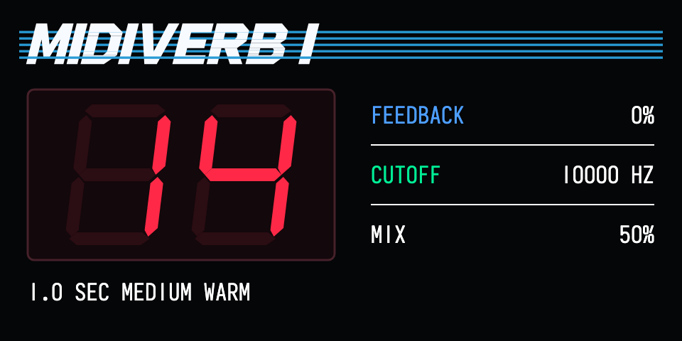

# Midiverb 0.2.9

A mono reverb and effects plugin for the original OP-1 with Opus core 2.8 or later. Use it in the synth or drum effect slot.

*Rendered screen preview with the MidiVerb I ROM bank selected.*

## Install

1. Enter disk mode with **Shift + COM**, then **T3**. Copy `midiverb.opmod` into `mods/`, replacing any older Midiverb build. Eject and restart.
2. Enter disk mode again. Midiverb creates `mods/mv1rom/`. Supply your own dump for each bank you want to use. Rename the files **exactly** as shown below, copy them into that folder, then eject and leave disk mode.
3. Select **midiverb** in the synth or drum effect list. Press Orange to cycle through the installed banks.

**ROM files are required and are not included.** Renaming a different revision will not make it compatible. The expected dumps are listed below.

| Bank | Required filename | Size | MD5 |
| --- | --- | ---: | --- |
| MidiVerb I | `midiverb.bin` | 16,384 bytes | `11a460c8e64d3325411bba0c11a2ae49` |
| MidiVerb II | `midiverb2.bin` | 32,768 bytes | `d503f74c239917b9888f247f979509ec` |
| MidiFex | `midifex.bin` | 16,384 bytes | `f06003307a93ec09c637146ecaa17948` |

## Controls

| Encoder | Turn | Press |
| --- | --- | --- |
| Blue | Feedback | |
| Green | Input cutoff | |
| White | Mix | |
| Orange | Program | Change ROM |

Bank order is **MidiVerb I → MidiVerb II → MidiFex**. Each bank remembers its own program for the current boot, separately on synth and drum. Changing the ROM or program clears the tail.

To open settings, select **Midiverb** in the Opus mods list and press **Blue**. Turn **Green** to change a setting.

- **Output-Filter** defaults to On. Set it to Off to bypass the wet-output reconstruction filter.
- **Engine** defaults to Original. Low CPU uses a simpler tank for 81 reverb presets. Other presets use their original algorithms. Switching engines clears the tail.

## Credits

- **LizardMan245 and the Opus contributors** for [Opus and its plugin SDK](https://github.com/LizardMan245/opus).
- **Eric Brombaugh and Paul Schreiber** for the [original MidiVerb reverse engineering](https://github.com/emeb/MIDIVerb_RE), including the compiler and circuit models.
- **thement and contributors** for [midiverb_emulator](https://github.com/thement/midiverb_emulator), including the MidiVerb II and MidiFex program code and modulation model.
- **Volker Junginger / ESC_CODE** for the Opus port.

This is an independent, unofficial project. It is not affiliated with, sponsored by, or endorsed by Alesis. Product names identify the original hardware and compatible ROM banks.

## Source

See the `Source/` folder in the [release ZIP](Midiverb-0.2.9.zip) for the Blackfin plugin, generation scripts, tests, and license notices. Build `Source/plugin` with the [Opus plugin kit](https://github.com/LizardMan245/opus/tree/81968daa84f865886526de9bf7cc86725ae493a1/plugin-kit). The source package includes compiled-bank source code and excludes the original ROM dumps.
